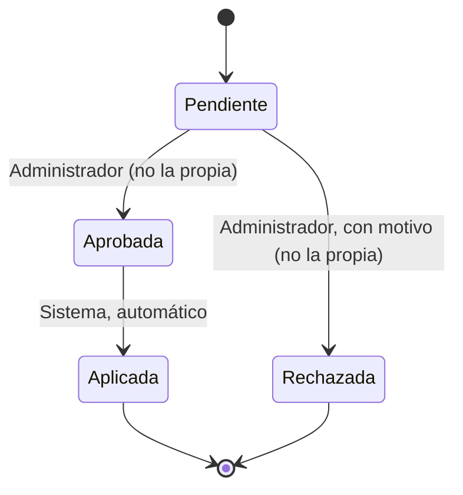

# Gestión de permisos — Solicitud de permiso

Pieza 2 del Core. Un usuario pide permiso para ejecutar una operación *otorgable*; un Administrador lo
resuelve. Al aprobar, el sistema aplica el permiso automáticamente (RF-GP-05).

## Dónde está en el código

| Qué | Dónde |
|---|---|
| Estados | `src/Core/Permisos/EstadoSolicitudPermiso.cs` |
| Transiciones permitidas (RD-04) — único punto | `src/Core/Permisos/TransicionesSolicitudPermiso.cs` → `Puede(desde, hacia)` y `Validar(desde, hacia)` |
| Entidad (cada cambio de estado pasa por la tabla antes de modificar nada) | `src/Core/Permisos/SolicitudPermiso.cs` |
| Reglas (RF-GP-01 a 07) | `src/Core/Permisos/ServicioPermisos.cs` |
| Operaciones otorgables y verificación en el servidor (RF-GP-05, RD-06) | `src/Core/Seguridad/PoliticasAcceso.cs` + `src/Api/Infraestructura/RequiereOperacionAttribute.cs` |
| Persistencia (RD-09) | Tablas `SolicitudesPermiso` y `PermisosUsuario` (`src/Core/Datos/RepositorioPermisosEf.cs`) |

## Estados

| Estado | Descripción | ¿Terminal? |
|---|---|---|
| `Pendiente` | Recién creada; espera resolución. Estado inicial (RF-GP-01). | No |
| `Aprobada` | Un Administrador la aprobó. Es momentáneo: en la misma operación el sistema la aplica. | No |
| `Aplicada` | El permiso ya está otorgado y el solicitante puede ejecutar la operación. | **Sí** |
| `Rechazada` | Un Administrador la rechazó con motivo. | **Sí** |

## Tabla de transiciones

| Desde | Hacia | Quién la ejecuta | Condición / qué registra |
|---|---|---|---|
| Pendiente | Aprobada | Administrador | No puede ser su propia solicitud (RF-GP-07). Registra `AprobadaPorId` y `FechaAprobacion` (RF-GP-03). |
| Aprobada | Aplicada | Sistema | Inmediatamente después de aprobar, en la misma operación: crea el `PermisoUsuario` y registra `FechaAplicacion` (RF-GP-05). |
| Pendiente | Rechazada | Administrador | Motivo escrito obligatorio y no puede ser su propia solicitud. Registra `RechazadaPorId`, `FechaRechazo` y `MotivoRechazo` (RF-GP-04). |
| *cualquier otra* | — | — | **Prohibida** (RF-GP-06): respuesta `409` y el estado no cambia. Ejemplos: aprobar dos veces (Aplicada → Aprobada), Rechazada → Aplicada, Rechazada → Aprobada, Pendiente → Aplicada. |

> Esta máquina es independiente de la de `OrdenCompra` del módulo de negocio (RF-NEG-09).
> Los registros de auditoría de la resolución llegan en la semana 14.
