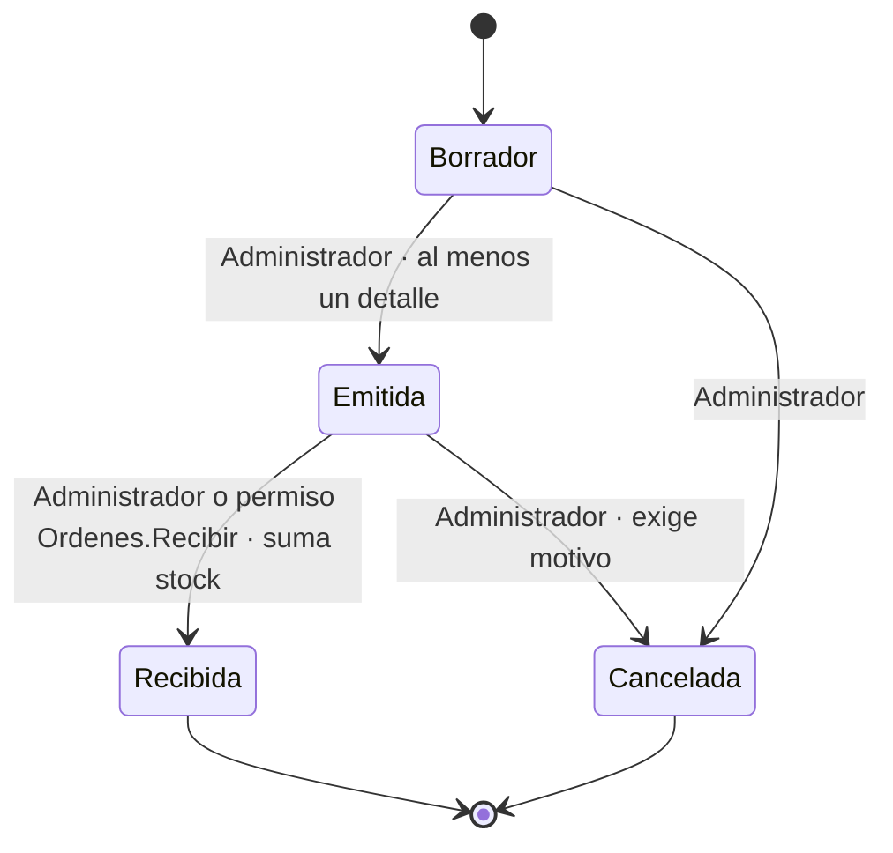

# Máquina de estados — Orden de compra

Módulo de negocio: **Inventario**. Entidad central: **`OrdenCompra`** (atributo `Estado`).

Entidades del módulo (RF-NEG-01): `Producto`, `Proveedor`, `OrdenCompra` (+ `DetalleOrdenCompra`) y `MovimientoStock`.

## Dónde está en el código

| Qué | Dónde |
|---|---|
| Estados (RF-NEG-03) — único lugar | `src/Negocio/Estados/EstadoOrdenCompra.cs` |
| Transiciones permitidas y prohibidas (RD-04) — único lugar | `src/Negocio/Estados/TransicionesOrdenCompra.cs` → `Puede`, `Validar`, `ProhibidasExplicitas` |
| Entidad: cada cambio de estado pasa por `Validar` antes de modificar nada | `src/Negocio/Dominio/OrdenCompra.cs` → `Emitir`, `Recibir`, `Cancelar` |
| Operaciones del negocio | `src/Negocio/Servicios/ServicioOrdenesCompra.cs` |
| Quién puede ejecutar cada operación (RF-NEG-06) | `src/Core/Seguridad/PoliticasAcceso.cs` |
| Pruebas de esta máquina | `tests/Core.Tests/Negocio/MaquinaEstadosOrdenCompraTests.cs` |

## Estados

| Estado | Descripción | ¿Terminal? |
|---|---|---|
| `Borrador` | Orden en preparación; se le agregan detalles. Estado inicial. | No |
| `Emitida` | Orden enviada al proveedor; ya no se editan los detalles. | No |
| `Recibida` | La mercancía llegó: se sumó el stock y se registraron los movimientos de entrada. | **Sí** (RF-NEG-05) |
| `Cancelada` | La orden se anuló y no tuvo efecto en el inventario. | **Sí** (RF-NEG-05) |

## Tabla de transiciones permitidas

| # | Desde | Hacia | Quién la ejecuta | Condición | Operación |
|---|---|---|---|---|---|
| 1 | Borrador | Emitida | Administrador | La orden tiene al menos un detalle | `POST /api/ordenes-compra/{id}/emitir` |
| 2 | Borrador | Cancelada | Administrador | — | `POST /api/ordenes-compra/{id}/cancelar` |
| 3 | Emitida | Recibida | Administrador, o Estándar con el permiso `Ordenes.Recibir` aprobado en Gestión de permisos | Suma el stock y registra un movimiento de entrada por detalle | `POST /api/ordenes-compra/{id}/recibir` |
| 4 | Emitida | Cancelada | Administrador | Exige motivo escrito | `POST /api/ordenes-compra/{id}/cancelar` |

## Tabla de transiciones prohibidas (RF-NEG-04)

Están declaradas, en este mismo orden, en `TransicionesOrdenCompra.ProhibidasExplicitas`. Intentarlas da `409` y el
estado no cambia.

| # | Desde | Hacia | Motivo | Cómo se intenta |
|---|---|---|---|---|
| 1 | Borrador | Recibida | No se recibe una orden que nunca se emitió | `POST .../recibir` sobre una orden en Borrador |
| 2 | Recibida | Cancelada | La mercancía ya entró al inventario | `POST .../cancelar` sobre una orden Recibida |
| 3 | Recibida | Emitida | Una orden recibida no se vuelve a emitir | `POST .../emitir` sobre una orden Recibida |
| 4 | Cancelada | Emitida | Una orden cancelada no se reactiva | `POST .../emitir` sobre una orden Cancelada |

Además, **cualquier par que no esté en la tabla de permitidas está prohibido**: de `Recibida` y de `Cancelada` no
parte ninguna transición (estados terminales).

## Diagrama

## Pruebas de cada fila

| Fila | Prueba |
|---|---|
| Permitida 1 | `Emitir_OrdenEnBorradorConDetalle_QuedaEmitidaConFechaDeEmision` |
| Permitida 1 (condición) | `Emitir_OrdenSinDetalles_SeRechazaYSigueEnBorrador` |
| Permitida 2 | `Cancelar_OrdenEnBorrador_QuedaCancelada` |
| Permitida 3 | `Recibir_OrdenEmitida_QuedaRecibidaYRegistraQuienYCuando` (stock y movimientos: `RecibirOrden_Administrador_SumaElStockDelProducto`, `RecibirOrden_Administrador_RegistraUnMovimientoDeEntradaPorDetalle`) |
| Permitida 3 (quién) | `RecibirOrden_EstandarSinPermiso_SeRechazaYLaOrdenSigueEmitida` y la prueba de integración |
| Permitida 4 | `Cancelar_OrdenEmitidaConMotivo_QuedaCanceladaYGuardaElMotivo` |
| Permitida 4 (condición) | `Cancelar_OrdenEmitidaSinMotivo_SeRechazaYSigueEmitida` |
| Prohibida 1 | `Recibir_OrdenEnBorrador_SeRechazaYSigueEnBorrador` |
| Prohibida 2 | `Cancelar_OrdenRecibida_SeRechazaYSigueRecibida` |
| Prohibida 3 | `Emitir_OrdenRecibida_SeRechazaYSigueRecibida` |
| Prohibida 4 | `Emitir_OrdenCancelada_SeRechazaYSigueCancelada` |
| Terminal Cancelada | `Cancelada_EsTerminal_NingunaTransicionParteDeElla`, `Cancelar_OrdenYaCancelada_SeRechazaYConservaLaFechaOriginal` |
| Terminal Recibida | `Recibida_EsTerminal_NingunaTransicionParteDeElla` |
| Tabla completa | `Puede_SoloPermiteLasTransicionesDeLaTabla` (16 pares) y `ProhibidasExplicitas_NingunaEstaPermitida` |

> Esta máquina es independiente de la de Gestión de permisos (RF-NEG-09): `EstadoOrdenCompra` y
> `TransicionesOrdenCompra` están en `src/Negocio` y no usan `EstadoSolicitudPermiso`. Cambiar los estados de las
> solicitudes no obliga a cambiar nada aquí; el negocio solo pregunta a Gestión de permisos qué permisos tiene el usuario.
